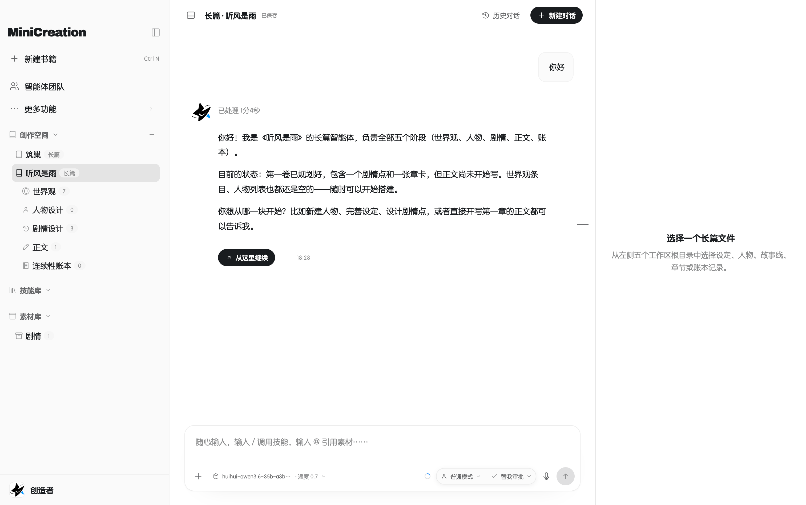
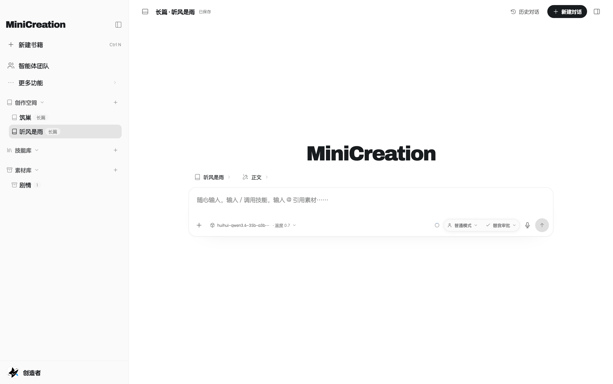

# MiniCreation

面向长篇小说、短篇与剧本的本地写作客户端：作品以本地 Markdown 保存，智能体围绕阶段、章节与正文协作修改。

本仓库只发布安装包、更新清单与许可材料，不包含源代码。

## 界面预览

### 长篇工作台：智能体协作

### 长篇工作台：正文与对话入口

截图中的作品名、模型名仅用于功能演示；未展示账号、密钥、服务器地址或其他凭据。

## 下载安装包

打开 [Releases](https://github.com/xiaoshideluobo/MiniCreation-releases/releases) 页面，按系统选择对应的文件：

| 系统 | 安装包 |
| --- | --- |
| Windows x64 | `MiniCreation-<版本>-win-x64-test.exe` |
| macOS Apple Silicon（M 系列） | `MiniCreation-<版本>-mac-arm64-test.dmg` |
| macOS Intel | `MiniCreation-<版本>-mac-x64-test.dmg` |
| Linux x64 | `MiniCreation-<版本>-linux-x86_64-test.AppImage` |
| Linux x64（Debian / Ubuntu） | `MiniCreation-<版本>-linux-amd64-test.deb` |

macOS：打开 `.dmg`，把 MiniCreation 拖进“应用程序”文件夹。目前安装包使用 ad-hoc 签名，没有经过 Apple 公证；从浏览器、微信等渠道下载后，系统可能提示“来自身份不明的开发者”。确认来源可信后，右键应用选择“打开”，或到“系统设置 → 隐私与安全性”里允许打开。

Windows：运行 `.exe`，按向导完成安装。安装包未做代码签名，SmartScreen 可能提示；选择“更多信息 → 仍要运行”即可。

首次启动后：选择本地工作目录，在“模型配置”里添加 API 服务并测试连接，然后新建作品或打开已有的 MiniCreation 项目文件夹。

## 自动更新

应用启动后会读取最新 Release 里的 `update.json`，与当前版本比较后提示更新，安装包由应用自行下载。

本仓库 `main` 分支下的 `update.json` 是同一份清单的副本，供 CDN 镜像读取；两处内容保持一致，正文以 Release 附件为准。

## 版权、授权与上游说明

MiniCreation 是独立开发的本地写作客户端，**不是 DeepWrite 的官方产品**，不代表上游立场，也不存在官方合作或背书关系。

### 上游作品

| 项目 | 内容 |
| --- | --- |
| 上游项目 | DeepWrite |
| 商用基线 | `v1.6.4` |
| 基线提交 | `69858fb1ae60a1fcc84b71122f945b1c86949049` |
| 上游许可证 | Apache License 2.0 |
| 上游仓库 | https://github.com/swjybky/deepwrite |
| 基线快照 | [69858fb1](https://github.com/swjybky/deepwrite/commit/69858fb1ae60a1fcc84b71122f945b1c86949049) |
| 基线许可证 | [Apache-2.0](https://github.com/swjybky/deepwrite/blob/69858fb1ae60a1fcc84b71122f945b1c86949049/LICENSE) |

MiniCreation 以该基线为基础进行了大量修改、重构、重新品牌化及功能增删，修改始于 2026-10-09。上游后续版本适用其各自版本附带的许可证，不自动纳入本项目。

### 关于上游后续许可证变更

本项目所依据的 DeepWrite `v1.6.4` 已按 Apache License 2.0 发布。Apache-2.0 第 2 条授予的权利是永久且不可撤销的（许可证本身规定的终止情形除外），因此上游在 `v1.6.4` 之后更换许可证，不会追溯改变该基线已经授予的权利。MiniCreation 不自动合并上游后续代码，也不因此改用上游后续版本附带的许可证。

### 许可证与声明

- [Apache License 2.0 全文](./LICENSES/Apache-2.0.txt)
- [NOTICE](./NOTICE)：上游名称、版本、基线提交、修改事实与第三方组件说明
- [MODIFICATIONS.md](./MODIFICATIONS.md)：修改范围、日期、文件级声明与分发要求
- [MiniCreation 许可协议](./LICENSE)：MiniCreation 原创部分的专有许可条款
- [Electron MIT 许可证](./LICENSES/Electron-MIT.txt)

项目源码与构建的安装包中，修改过的可注释文本文件保留文件头变更声明；JSON、图片、标准许可证文本和生成锁文件等不能承载注释的格式，在 `MODIFICATIONS.md` 中集中列明。Chromium 及 Electron 内置第三方组件的许可证文本随安装包提供。

### 权利边界

- DeepWrite 相关代码及其修改版本继续按 Apache-2.0 授权。
- DeepWrite 的名称与相关权利归其权利人；MiniCreation 独立创作的界面、文案、品牌和新增功能归 MiniCreation 所有。
- MiniCreation 原创部分按根目录 `LICENSE` 授权；如需商业使用原创部分，请先取得书面授权。
- MiniCreation 的专有条款不限制 Apache-2.0 已经授予的复制、修改、商用和再分发权利，但该等权利仅适用于 Apache-2.0 衍生成分。
- Apache-2.0 允许以源码或目标码形式分发，不要求公开 MiniCreation 的自研源代码；Apache-2.0 也不授予 DeepWrite 商标使用权。

### 二次分发

分发 Apache-2.0 衍生成分时，请保留 `LICENSES/Apache-2.0.txt`、`NOTICE`、`MODIFICATIONS.md` 及相关文件头声明。上述材料也随安装包提供。

如对署名、许可证或修改声明有疑问，请通过本仓库 Issue 联系维护者。
