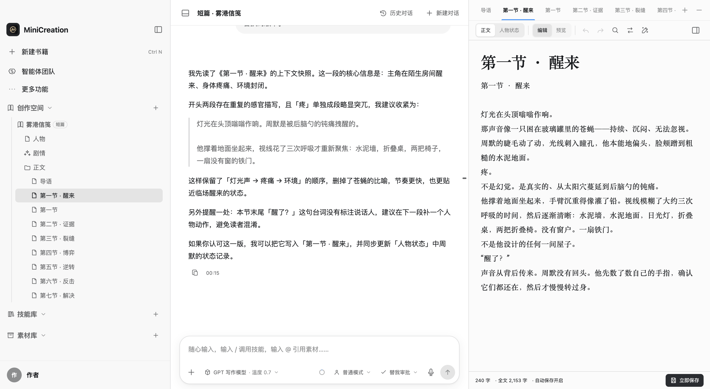
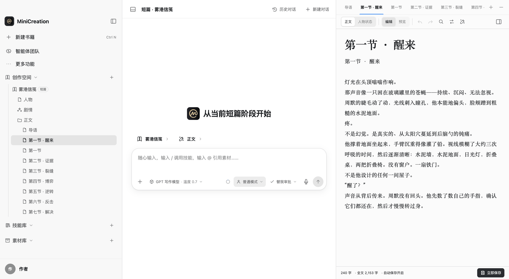
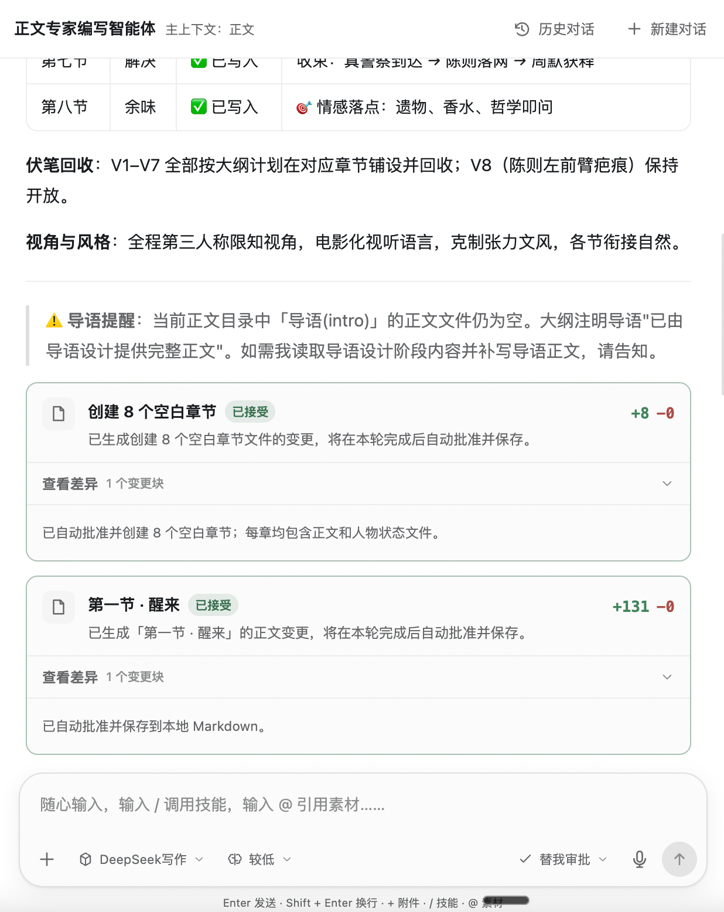

# MiniCreation

面向长篇小说、短篇与剧本的本地写作客户端：作品以本地 Markdown 保存，智能体围绕阶段、章节与正文协作修改。

这个仓库只放 **安装包和更新清单**，不包含任何源代码。应用程序的源代码保存在私有仓库，不对外公开。

## 界面

## 下载安装包

打开 [Releases](https://github.com/xiaoshideluobo/MiniCreation-releases/releases) 页面，按系统选择对应的文件：

| 系统 | 安装包 |
| --- | --- |
| Windows x64 | `MiniCreation-<版本>-win-x64-test.exe` |
| macOS Apple Silicon（M 系列） | `MiniCreation-<版本>-mac-arm64-test.dmg` |
| macOS Intel | `MiniCreation-<版本>-mac-x64-test.dmg` |
| Linux x64 | `MiniCreation-<版本>-linux-x86_64-test.AppImage` |
| Linux x64（Debian / Ubuntu） | `MiniCreation-<版本>-linux-amd64-test.deb` |

macOS：打开 `.dmg`，把 MiniCreation 拖进“应用程序”文件夹。目前安装包使用 ad-hoc 签名，没有经过 Apple 公证；从浏览器、微信等渠道下载后，系统可能提示“来自身份不明的开发者”。确认来源可信后，右键应用选择“打开”，或到“系统设置 → 隐私与安全性”里允许打开。

Windows：运行 `.exe`，按向导完成安装。安装包未做代码签名，SmartScreen 可能提示；选择“更多信息 → 仍要运行”即可。

首次启动后：选择本地工作目录，在“模型配置”里添加 API 服务并测试连接，然后新建作品或打开已有的 MiniCreation 项目文件夹。

## 自动更新

应用启动后会读取最新 Release 里的 `update.json`，与当前版本比较后提示更新，安装包由应用自行下载。

本仓库 `main` 分支下的 `update.json` 是同一份清单的副本，供 CDN 镜像读取；两处内容保持一致，正文以 Release 附件为准。

## 这里有哪些文件

- Release 附件：各平台安装包、`latest-*.yml`（更新用的版本与校验信息）、`update.json`（更新公告与下载地址）。
- `main` 分支：本说明文件、`screenshots/` 界面截图、`update.json` 副本、`NOTICE` 与 `LICENSES/Apache-2.0.txt` 许可证说明。

这里**没有**应用程序源代码、构建脚本或任何密钥、账号等配置文件。

## 许可证声明

安装包中的程序为专有软件，其中包含第三方与上游开源组件（Apache License 2.0）。相关声明见 [`NOTICE`](./NOTICE)，许可证全文见 [`LICENSES/Apache-2.0.txt`](./LICENSES/Apache-2.0.txt)，专有许可条款随安装包一并提供。
